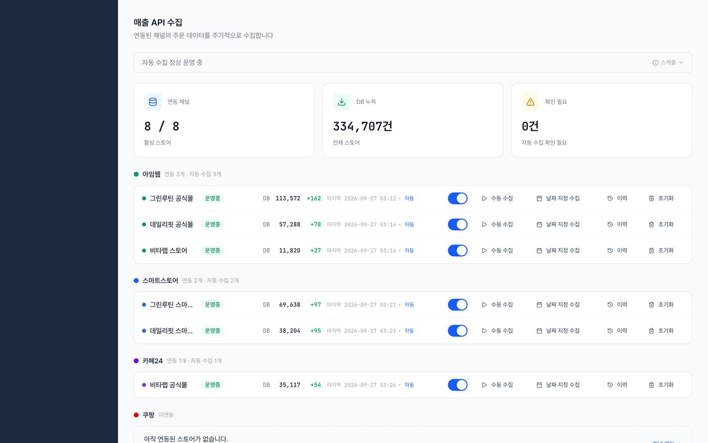
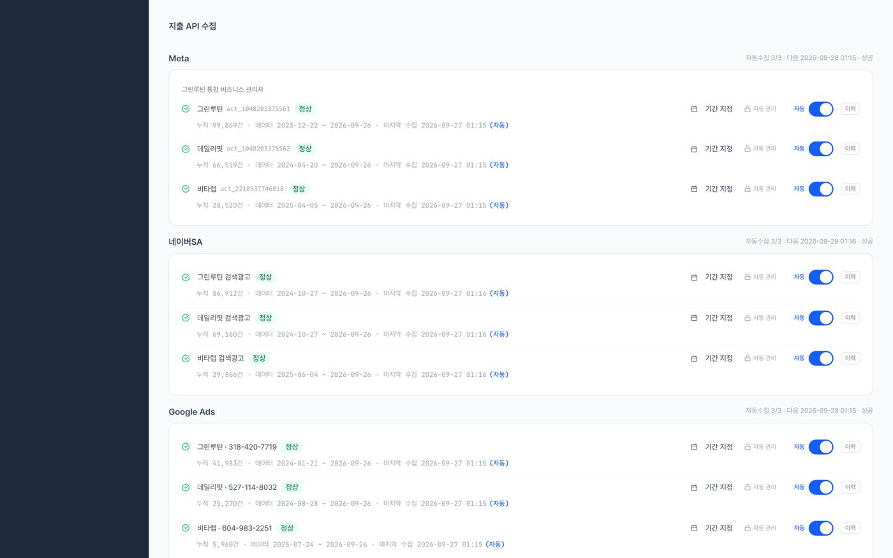
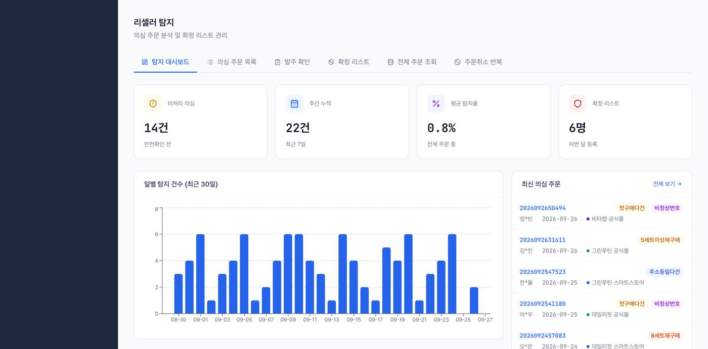
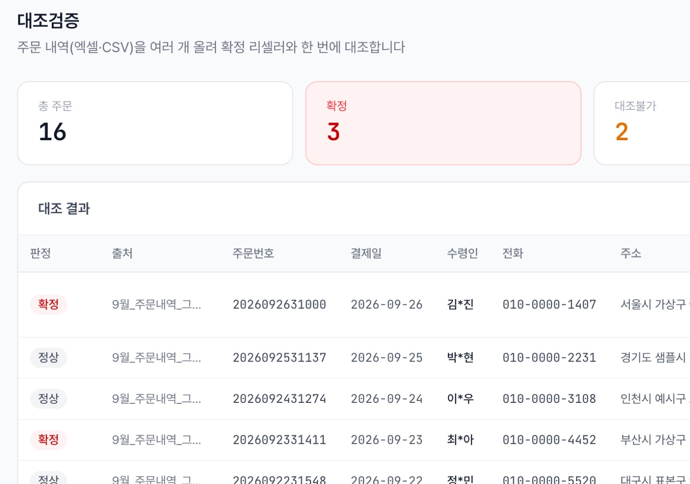
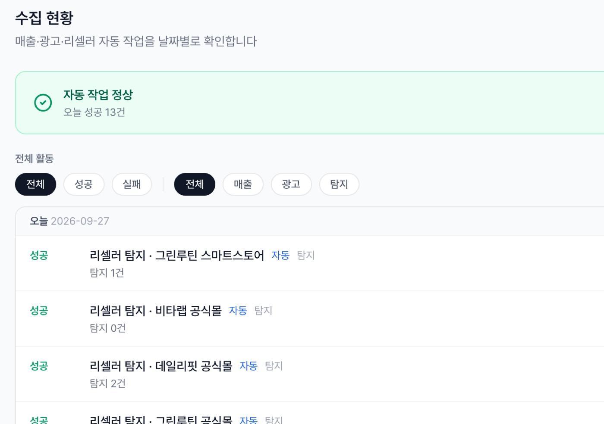

<div align="center">

# 양종태 (YANG JONGTAE)

**AI로 빠르게 만들고, 직접 검증하는 개발자**

회사의 유일한 개발자로 사내 운영 플랫폼을 혼자 만들고 운영하고 있습니다.<br>
팀 프로젝트에서는 백엔드와 실시간 기능을 맡았습니다.

[](mailto:didwhdxo74@gmail.com)
[](https://github.com/whdxo)

</div>

---

##  소개

문제를 먼저 정의하고, **AI에게 맡길 일과 제가 판단할 일을 나눠서** 일합니다.
AI는 빠르지만 틀리기 때문에, 범위와 승인과 검증은 제가 쥡니다.

| 기간 | 내용 |
| --- | --- |
| 2026.02 — 현재 | **사내 개발팀**, 회사의 유일한 개발자로 매출, 광고비, 리셀러 관리 플랫폼을 기획, 개발, 운영 |
| 2026.02 | **구름톤 딥다이브 풀스택 16회차** 수료, 우수수료생 선발 |

**숫자로 보면**

| 1인 | 2~4시간 → 5분 | 0원 | 약 1,470개 |
| :---: | :---: | :---: | :---: |
| 사내 플랫폼 기획, 개발, 운영 | 하루 수작업 시간 | 매출 집계 오차 (원본 대조) | 작성한 테스트 |

---

##  AI와 일하는 방식

| 단계 | 제가 하는 일과 AI에게 맡기는 일 | 남는 결과물 |
| --- | --- | --- |
| **01 정의** | 요청을 요구사항으로 정리하고, "문서만"인지 "구현까지"인지 먼저 정합니다. AI는 코드와 데이터를 읽고 진단 문서를 씁니다. | 요구사항 정의서, 진단 문서 |
| **02 설계** | AI가 후보 비교표와 설계 초안을 만들면, 비용과 운영 조건을 따져 제가 고릅니다. | 설계 문서, 뒤집힌 판단 기록 84건 |
| **03 구현** | 제가 승인한 범위만 구현합니다. 테스트를 먼저 쓰고, 범위가 분명한 기능은 Codex에 맡깁니다. | 커밋 2,059, PR 321 |
| **04 검증** | AI가 테스트와 실측을 돌리고, 저는 결과를 운영 DB, 관리자 화면, 장부와 원 단위로 대조합니다. | 테스트 약 1,470개, 대조검증 문서 |
| **05 기록** | 배포는 제가 직접 합니다. AI의 실수는 다음 작업에서도 읽히는 규칙으로 남깁니다. | CLAUDE.md, 규칙 23개 |

---

##  주요 프로젝트

| # | 프로젝트 | 한 줄 소개 | 역할 | 코드 |
| :---: | --- | --- | --- | :---: |
| 01 | SCR 플랫폼 | 매출, 광고비, 리셀러 관리 사내 플랫폼 | 1인 개발, 운영 | 비공개 (화면, 설명으로 대신) |
| 02 | [ManalGak](https://github.com/CHOSSEANG/ManalGak-magicDev) | 모임 중간 지점 + 맛집 추천 | 팀장, 백엔드 | [공개](https://github.com/CHOSSEANG/ManalGak-magicDev) |
| 03 | [EditUs](https://github.com/whdxo/web_ide_project) | 브라우저 Web IDE + AI 코드 리뷰 | 통합 담당, 풀스택 | [공개](https://github.com/whdxo/web_ide_project) |
| 04 | [BallPang](https://github.com/whdxo/ballpang_app) | 야구장 매장, 경기 일정 통합 앱 | 팀장, 풀스택 | [공개](https://github.com/whdxo/ballpang_app) |

> SCR 플랫폼을 뺀 3개는 **공개 저장소**입니다. 각 프로젝트의 **저장소 바로가기** 버튼을 누르면 전체 코드와 문서를 볼 수 있습니다.

### 01. SCR 플랫폼 — 매출, 광고비, 리셀러 관리 `실무, 1인 개발`

> 엑셀 매크로로 하던 리셀러 탐지를, 매출, 광고비, 리셀러를 한 화면에서 보는 사내 운영 플랫폼으로 키웠습니다.

> [!NOTE]
> **비공개 프로젝트입니다.** 사내 서비스라 저장소는 공개할 수 없습니다. 대신 아래에 **쉬운 설명과 실제 화면(가상 데이터)** 을 넣었고, 어떻게 만들었는지는 "자세히 보기"에 정리했습니다.


| 기간 | 역할 | 사용자 | AI |
| --- | --- | --- | --- |
| 2026.02 — 현재 (운영하며 계속 개발) | 사내 유일한 개발자, 기획부터 운영까지 1인 | 대표 포함 사실상 전 직원, 매일 사용 | Claude Code, Codex |

**한눈에 보기**

- 하루 **2~4시간** 걸리던 엑셀 다운로드, 붙여넣기, 수동 검색 → **5분**
- 쇼핑몰 스토어 11곳, 광고 채널 6곳 데이터를 **매일 새벽 사람 없이** 자동 수집
- 에러 없이 틀리던 매출 집계를 원 단위 대조로 잡아 **원본과 0원 차이**
- 아침마다 멈추던 서비스: 로그인 **45초 → 0.5초**, 503 오류 **34건 → 0건**
- 월 운영 비용 **0~7,000원**, 장애도 플랜 상향 없이 해결

#### 쉽게 말하면

회사는 여러 쇼핑몰에서 물건을 팔고, 여러 곳에 광고를 합니다.
예전에는 직원이 매일 쇼핑몰마다 들어가 주문 엑셀을 내려받고, 광고비를 하나씩 옮겨 적고,
**리셀러**(싸게 대량으로 사서 되파는 사람)를 찾으려고 전화번호, 주소를 한 명씩 검색했습니다.

SCR은 이 일을 대신 해 주는 사내 웹 서비스입니다. 하는 일은 네 가지입니다.

| 단계 | SCR이 하는 일 | 사람이 하던 일 |
| :---: | --- | --- |
| **1. 모으기** | 매일 새벽, 쇼핑몰과 광고 플랫폼에서 주문과 광고비를 자동으로 가져옴 | 사이트마다 들어가 엑셀 내려받기 |
| **2. 보여주기** | 날짜별 매출, 광고비, **ROAS**(광고비 1원당 매출)를 한 화면에 | 엑셀에 손으로 합산 |
| **3. 찾아내기** | 같은 전화번호, 주소로 여러 번 산 주문을 자동으로 의심 목록에 | 한 명씩 최대 24번 검색 |
| **4. 확인하기** | 자동 작업이 잘 돌았는지, 실패한 곳은 없는지 날짜별로 기록 | 없음 (빠져도 몰랐음) |

#### 화면으로 보는 SCR

> 화면은 실제 서비스에 **가상 데이터**(가상 스토어, 가상 고객)를 넣어 다시 찍은 것입니다.

**① 통합 성과** — 매출, 광고비, ROAS를 날짜별, 쇼핑몰별로 한 표에서 봅니다. 엑셀로도 내려받을 수 있습니다.

<p align="center"></p>

**② 자동 수집** — 쇼핑몰(왼쪽)과 광고 플랫폼(오른쪽)마다 연결 상태, 쌓인 데이터 수, 마지막 수집 시간이 보입니다. 끄고 켜거나 날짜를 지정해 다시 수집할 수도 있습니다.

<p align="center">
  
  
</p>

**③ 리셀러 탐지** — 수집이 끝나면 바로 탐지가 돌아, 의심 주문과 그 이유("첫구매 다건", "5세트 이상 재구매" 등)를 보여 줍니다. 담당자는 이 목록만 확인하면 됩니다.

<p align="center"></p>

**④ 대조검증, 수집 현황** — 발주 직전에 주문 엑셀을 올리면 확정 리셀러와 한 번에 대조합니다(왼쪽). 새벽 자동 작업이 성공했는지 실패했는지 날짜별로 남습니다(오른쪽).

<p align="center">
  
  
</p>


<details>
<summary> <b>자세히 보기 — 어떻게 만들었나 (구조, 장애 해결, 회고)</b></summary>

#### 1) 만들기 전: 리셀러 한 명을 확인하려고 최대 24번 검색

| 기존 업무 흐름 | 비용 |
| --- | --- |
| 하루 2번, 쇼핑몰 관리자에서 주문 엑셀 6개를 내려받아 매크로 시트마다 붙여넣고 실행 | 리셀러 확인에 하루 2~4시간 |
| 의심 고객 1명마다 전화번호, 주소로 최대 24번 수동 검색 | 하루 최대 240회 수동 검색 |
| 매출, 광고비는 채널마다 따로 확인해 엑셀로 수기 합산 | 관리자 화면 9개(쇼핑몰 4, 광고 5)를 오감 |

기획자의 요청("매크로를 웹으로")에서 시작해 담당자와 요구사항을 정리했고, 웹앱, 설치형 앱, 매크로 개선을 비교해 **웹앱**을 제안했습니다.

#### 2) 구조: 첫날은 매크로를 그대로 옮기고, 이후 구조를 통째로 확장

```
[매출 API 3종]  아임웹, 스마트스토어, 카페24  ─┐
[광고 API 5종]  메타, 구글, 네이버, 카카오, 틱톡 ─┼─▶ FastAPI 서버 (Fly.io, 매일 새벽 자동 수집)
[엑셀 업로드]   쿠팡 매출, 광고, 발주          ─┘     수집기 11종 → 정규화 → 매출, 광고비 집계
                                                        → 제품별 배분 → 리셀러 탐지
                                                                │
                                         PostgreSQL (원본 + 집계표) ─▶ Next.js 화면 (Vercel)
```

| 결정 | 대안 | 고른 이유 |
| --- | --- | --- |
| PostgreSQL | Firebase, NAS + SQLite | 한 주문의 전화번호 4개 교차 대조, 주소 부분 검색에 관계형 쿼리가 필요. 무료 한도 안에서 시작 |
| 잠들지 않는 서버 (Fly.io) | Render, Railway | 새벽 자동 수집이 돌아야 해서 슬립 없는 서버가 필요. 월 0~7,000원 |
| 하루 만에 배포 → 나중에 분리 | 처음부터 완성형 구조 | 매크로 로직을 옮겨 요청 다음 날 바로 실사용. 범위가 매출, 광고비로 넓어진 시점에 FastAPI + Next.js로 전환 |

#### 3) 정확성: 에러 한 줄 없이 틀린 매출을, 원 단위 대조로 잡음

| | |
| --- | --- |
| **문제** | 에러는 없는데 매출 집계가 전 스토어, 전 기간에서 틀림 |
| **발견** | 관리자 화면, 수기 장부와 원 단위로 대조하다 같은 조회를 두 번 하면 숫자가 다른 걸 확인 |
| **원인** | 정렬 없이 페이지 단위로 나눠 읽으면 PostgreSQL은 페이지마다 순서가 달라져 행이 중복/누락됨 (병렬 조회로 악화) |
| **수정** | 안정 정렬 강제 + 월 단위 재집계 → 9개 스토어 원본과 **0원 차이**. 정렬 규칙은 테스트로 고정 |
| **재발 방지** | "건수 대조" 규칙을 문서와 AI 메모리에 기록, 대조검증을 모든 작업의 필수 단계로 |
| **그 뒤** | AI가 짠 조사용 쿼리에서 같은 실수가 또 나왔지만(7,415건 중 4,756건만 조회) 건수 대조에서 바로 걸림 |

→ 규칙만으로는 부족했습니다. **결과를 외부 기준과 대조해야** AI의 실수가 잡힙니다.

#### 4) 성능 장애: 아침마다 멈추던 서비스, 원인은 인덱스가 아니었음

| | |
| --- | --- |
| **증상** | 아침마다 로그인이 안 되고 대시보드가 빈 화면, DB 과부하 경고 반복 |
| **원인** | 데이터가 바뀔 때마다 캐시를 통째로 비우고 원본 주문 14만 건을 다시 읽어 집계 → 정렬이 메모리를 넘어 디스크 임시파일 약 400GB |
| **해결** | 바뀐 부분만 캐시 삭제, 집계는 DB 함수, 사전 집계표로, 동시 요청은 한 번만 계산 |
| **AI** | AI가 닷새간 원인을 세 번 단정했고 두 번 틀림 → 증상 쫓기를 멈추고 읽기 전용 전체 점검으로 결함 13개를 한 번에 정리 |

| 지표 | 전 | 후 |
| --- | ---: | ---: |
| 로그인 | 45초 | **0.5초** |
| 전체 기간 매출 집계 | 2분+ (타임아웃) | **3.4초** |
| 월별 추이 | 12.9초 | **0.3초** |
| 503 오류 | 34건 | **0건** |

→ 결과를 원인으로 착각하지 않도록, **추정 대신 실측부터** 합니다.

#### 5) 데이터 수집 자동화: 매일 새벽, 사람 없이

- **매출** 쇼핑몰 API로 매일 최근 7일치를 다시 수집. 취소, 반품, 미입금, 사은품, 중복을 걸러 순매출로 집계
- **광고비** 광고 플랫폼 API + 쿠팡 엑셀. 캠페인, 키워드 규칙으로 제품별로 나누되 **계정 총액과 1원도 다르지 않게**, 모르는 건 미분류로
- **운영** 7일마다 끊기던 구글 인증은 재인증 버튼으로, "성공처럼 보이던" 카카오 저장 실패는 실패로 드러나도록 수정
- **리셀러 탐지** 수집 직후 자동 실행 → 담당자는 의심 목록만 검토

#### 6) 결과와 회고

> "예전보다 시간이 훨씬 줄었고, 매출이랑 지출을 한 번에 볼 수 있어서 편하다." — 대표<br>
> "수기로 하나하나 찾던 리셀러를 이제 자동으로 탐지해 줘서, 확인하는 시간이 엄청 줄었다." — 운영 담당

혼자 개발할수록 실제로 쓰는 분들과 자주 소통하며 **숫자로 확인시켜 드리는 일**이 기능만큼 중요했습니다.
다시 만든다면 원본과 집계 데이터를 처음부터 나누고, 외부 기준과의 대조를 초기부터 자동화하겠습니다.

</details>

### 02. [ManalGak](https://github.com/CHOSSEANG/ManalGak-magicDev) — 모임 중간 지점 + 맛집 추천 `팀장, 백엔드`

> 모두의 이동 시간이 비슷한 중간 지점과 장소를 추천하는 모바일 웹

> [!TIP]
> **공개 저장소입니다.** 여기에는 핵심만 적었고, 전체 코드와 문서는 저장소에서 직접 보실 수 있습니다. 아래 "직접 작성한 코드"에서 제 파일로 바로 이동할 수 있습니다.
>
> [](https://github.com/CHOSSEANG/ManalGak-magicDev)


| 기간 | 역할 | 맡은 일 | AI |
| --- | --- | --- | --- |
| 2026.01 — 2026.02 (4주, 구름톤 딥다이브 팀 프로젝트) | 팀장, 백엔드 (5명 중 BE 3, FE 2) | 외부 API 연동, Redis 캐시, 지도, 이동시간 화면 | Claude Code (설계, 구현 보고서를 남기며 개발) |

**한눈에 보기**

- 경로 조회 **약 400ms → 약 50ms** (캐시 히트)
- 참여자 4명 경로 **1.2초 → 0.4초** (병렬 조회)
- 데이터마다 다른 캐시 수명: 장소 **1시간**, 경로 **30분**, 막차 **10분**
- 출발지가 바뀌면 **그 모임의 캐시만** 골라 지우고 화면에 실시간 알림

<table align="center">
<tr>
<td align="center" width="50%">
  <br>
  <b>① 모임 만들기</b><br>
  <sub>모임 이름, 목적(음식점, 카페 등), 날짜와 시간을 고르면 그날 날씨도 함께 보여 줍니다</sub>
</td>
<td align="center" width="50%">
  <br>
  <b>② 중간 지점, 추천 장소</b><br>
  <sub>참여자별 출발지와 경로를 지도에 그리고, 모두에게 공평한 추천 장소를 표시합니다</sub>
</td>
</tr>
<tr>
<td align="center" colspan="2">
  <br>
  <b>③ 참여자별 이동시간</b><br>
  <sub>고른 장소까지 각자 몇 분 걸리는지 대중교통, 자동차로 나눠 비교합니다</sub>
</td>
</tr>
</table>

<details>
<summary> <b>자세히 보기 — 문제부터 회고까지</b></summary>

#### 1) 문제: 같은 경로를 매번 외부 API에 다시 묻고 있었음

추천 장소, 경로, 막차를 볼 때마다 카카오, ODsay API를 새로 호출했습니다.
화면이 느렸고, 참여자가 늘수록 호출 수가 곱으로 늘어 **호출 한도에 가까워졌습니다.**

#### 2) 구조: 있으면 꺼내 쓰고, 없을 때만 외부 API를 부름

```
요청 ─▶ Redis 캐시 ──있음──▶ 바로 응답 (약 50ms)
           │ 없음
           ▼
         DB ──있음──▶ 응답 + Redis에 저장
           │ 없음
           ▼
     외부 API (카카오, ODsay) ─▶ 응답 + DB, Redis에 저장 (약 400ms)
```

#### 3) 수명: 바뀌는 속도가 다른 데이터라 유지 시간도 다르게

| 데이터 | 수명 | 이유 |
| --- | --- | --- |
| 추천 장소 | 1시간 | 장소 정보는 자주 바뀌지 않고, 카카오 호출을 줄여야 함 |
| 경로 | 30분 | 교통 상황이 시간대별로 바뀌어 너무 오래된 경로는 부정확 |
| 막차 | 10분 | 막차 시간 확인용이라 실시간성이 가장 중요 |
| AI 요약 | 24시간 | 같은 입력이면 결과가 같고, OpenAI 호출 비용이 큼 |

캐시 키는 `places:meeting:{모임}:candidate:{후보지}:{목적}:{개수}`처럼 **모임 단위로 묶이게** 규칙을 정했습니다.
그래서 나중에 "이 모임 것만" 골라 지울 수 있습니다.

#### 4) 무효화: 빠르게 만드는 것보다, 언제 지울지가 더 어려웠음

- 참여자가 출발지를 바꾸면 **그 모임, 그 참여자와 관련된 캐시만** 찾아서 삭제
- 키를 찾을 때 `KEYS` 대신 `SCAN`을 사용: 운영 중인 Redis를 멈추지 않기 위해
- 지운 뒤에는 같은 모임 참여자 화면에 실시간으로 알려 오래된 경로를 보지 않게 함

#### 5) 병렬 조회: 참여자 경로를 한 명씩이 아니라 동시에

참여자마다 순서대로 경로를 묻던 것을 `CompletableFuture`로 동시에 요청해, 4명 기준 **1.2초 → 0.4초**로 줄였습니다.

#### 6) 직접 작성한 코드

| 파일 | 하는 일 |
| --- | --- |
| [`CacheTTL.java`](https://github.com/CHOSSEANG/ManalGak-magicDev/blob/develop/backend/src/main/java/com/magicdev/manalgak/common/cache/CacheTTL.java) | 데이터별 캐시 수명과 그 이유 |
| [`CacheKeys.java`](https://github.com/CHOSSEANG/ManalGak-magicDev/blob/develop/backend/src/main/java/com/magicdev/manalgak/common/cache/CacheKeys.java) | 모임 단위로 묶이는 캐시 키 규칙 |
| [`CacheInvalidationService.java`](https://github.com/CHOSSEANG/ManalGak-magicDev/blob/develop/backend/src/main/java/com/magicdev/manalgak/common/cache/CacheInvalidationService.java) | 모임, 후보지, 참여자 단위 캐시 삭제 (SCAN) |
| [`OdsayApiService.java`](https://github.com/CHOSSEANG/ManalGak-magicDev/blob/develop/backend/src/main/java/com/magicdev/manalgak/domain/external/odsay/service/OdsayApiService.java) | 참여자 경로 병렬 조회 |
| [`LastTrainService.java`](https://github.com/CHOSSEANG/ManalGak-magicDev/blob/develop/backend/src/main/java/com/magicdev/manalgak/domain/odsay/service/LastTrainService.java) | 막차 조회와 캐시 |
| [`PlaceCacheService.java`](https://github.com/CHOSSEANG/ManalGak-magicDev/blob/develop/backend/src/main/java/com/magicdev/manalgak/domain/place/service/PlaceCacheService.java) | 추천 장소 캐시 |

#### 7) AI 활용과 회고

- Claude Code와 **캐시 키, 수명 설계를 문서로 먼저 정리한 뒤** 구현하고, 결과를 보고서로 남겼습니다.
- 팀장으로서 백엔드 3명이 같은 규칙으로 캐시를 쓰도록 키와 수명을 공통 코드로 묶어 두었습니다.
- 빠르게 만드는 것보다, **언제 지워야 하는지 정하는 게** 더 어려웠습니다.

</details>

### 03. [EditUs](https://github.com/whdxo/web_ide_project) — 브라우저 Web IDE `통합 담당, 풀스택`

> 설치 없이 브라우저에서 함께 코딩하고, 실행하고, AI 리뷰까지 받는 Web IDE

> [!TIP]
> **공개 저장소입니다.** 여기에는 핵심만 적었고, 전체 코드와 문서는 저장소에서 직접 보실 수 있습니다.
>
> [](https://github.com/whdxo/web_ide_project)


-010101?style=flat-square&logo=socketdotio&logoColor=white)


| 기간 | 역할 | 맡은 일 | AI |
| --- | --- | --- | --- |
| 2025.12 (4주, 구름톤 딥다이브 팀 프로젝트) | 통합 담당, 풀스택 (6명 중 커밋 최다) | AI 코드 리뷰, 코드 실행, 채팅 배포 안정화 | 서비스: GPT-4o-mini<br>개발: Claude Code |

**한눈에 보기**

- 코드 작성 → 실행 → **AI 리뷰(점수, 요약, 개선 제안)** 가 한 화면에서
- Judge0 API로 **10개 언어** 실행 (Python, Java, JavaScript, TypeScript, C, C++, Go, Rust, Ruby, PHP)
- 배포 직후 **채팅 접속자 0명** 장애를 연결 경로 점검으로 찾아 해결
- 팀 채팅은 WebSocket(STOMP) + Redis Pub/Sub, 파일은 AWS S3에 저장

<p align="center">
  
  <br>
  <sub>코드 작성 → 실행 → AI 리뷰(점수, 요약, 개선 제안)가 한 화면에서</sub>
</p>

<details>
<summary> <b>자세히 보기 — 문제부터 회고까지</b></summary>

#### 1) 문제: 환경 설정에 첫날을 쓰고 있었음

OS, 버전이 달라 로컬 환경 구성에 시간이 걸리고, 에디터, 리뷰, 채팅 도구가 흩어져 있었습니다.

#### 2) 제가 만든 것

| 기능 | 내용 |
| --- | --- |
| AI 코드 리뷰 | 파일을 보내면 점수, 한 줄 요약, 개선점 3~5개를 JSON으로 받아 이력과 함께 저장 |
| 코드 실행 | Judge0 API로 10개 언어 실행, 입력값(stdin)과 결과, 오류를 화면에 표시 |
| 통합 | 프론트, 백엔드 응답 형식 불일치 4곳 정리 (파일을 열면 검은 화면이 뜨던 문제) |
| 채팅 | 한글 입력 시 메시지가 두 번 전송되던 문제 수정 |

#### 3) 배포 장애: 배포하자 채팅 접속자가 0명, 로컬에서는 멀쩡했음

```
브라우저 (useChat.ts) ─▶ 접속 주소 만들기 ─✕─▶ 서버 STOMP (/ws-chat) ─▶ Redis Pub/Sub
                          VITE_API_URL → undefined
```

| | |
| --- | --- |
| **원인** | 프론트가 존재하지 않는 환경변수를 읽어 기본 주소로 접속 → 서버가 여는 `/ws-chat`이 아닌 `/ws`로 연결 시도 |
| **해결** | WebSocket 주소 변수를 먼저 쓰고, 없으면 API 주소에서 `/ws-chat` 경로를 만들도록 수정. 접속자 수 메시지는 DB에 저장하지 않게 분리 |
| **AI** | 연결 경로(브라우저 → Nginx → 서버 → Redis)를 문서로 점검해 원인을 좁히고, 수정 커밋은 Claude Code와 공동 작성 |

#### 4) 다시 한다면

지금의 AI 리뷰는 서버가 OpenAI 응답을 끝까지 기다리는 **동기 호출**입니다.
응답이 늦으면 요청이 묶이고, 타임아웃이나 재시도가 없어 실패하면 사용자는 오류만 보게 됩니다.
다시 만든다면 리뷰 요청을 큐에 넣어 비동기로 처리하고, 끝나면 이미 쓰고 있는 WebSocket으로 알려 주겠습니다.
여기에 타임아웃, 재시도, 응답 형식 검증을 먼저 넣겠습니다.

#### 5) 주요 코드

| 파일 | 하는 일 |
| --- | --- |
| [`AIReviewService.java`](https://github.com/whdxo/web_ide_project/blob/main/backend/src/main/java/com/editus/backend/domain/ai/service/AIReviewService.java) | OpenAI 호출, 리뷰 결과 저장 |
| [`AIReviewPanel.tsx`](https://github.com/whdxo/web_ide_project/blob/main/frontend/src/features/ai/components/AIReviewPanel.tsx) | 리뷰 요청, 결과, 이력 화면 |
| [`CodeExecutionService.java`](https://github.com/whdxo/web_ide_project/blob/main/backend/src/main/java/com/editus/backend/domain/code/service/CodeExecutionService.java) | Judge0 연동, 언어별 실행 |
| [`useChat.ts`](https://github.com/whdxo/web_ide_project/blob/main/frontend/src/features/chat/hooks/useChat.ts) | 채팅 연결 (배포 장애를 고친 곳) |

</details>

### 04. [BallPang](https://github.com/whdxo/ballpang_app) — 야구장 매장, 경기 일정 통합 앱 `팀장, 풀스택`

> 야구장 관람객이 경기 일정, 구장 안 매장, 매장 위치를 한곳에서 확인하는 모바일 앱

> [!TIP]
> **공개 저장소입니다.** 여기에는 핵심만 적었고, 전체 코드와 문서는 저장소에서 직접 보실 수 있습니다.
>
> [](https://github.com/whdxo/ballpang_app)


| 기간 | 역할 | 맡은 일 |
| --- | --- | --- |
| 2025.03 — 2025.11 (핵심 개발 3~6월) | 팀장, 풀스택 (4명 중 커밋 최다) | Firebase 구조 설계, 지도와 매장 마커, 경기 일정, 앱 구조 리팩토링 |

**한눈에 보기**

- 전국 **9개 KBO 구장**의 식음료 매장 정보를 구장별 JSON 스키마로 정리
- Kakao Map 위에 매장 위치를 핀으로 표시하고, **층, 방향, 구역, 음식 종류**로 바로 필터
- 좌표를 **비율 값**으로 저장해 화면 크기가 달라도 마커 위치가 어긋나지 않게
- 시즌 경기 일정을 크롤링해 Firestore에 저장하고, 구장별 날씨(OpenWeather)와 함께 표시

<table align="center">
<tr>
<td align="center" width="50%">
  <br>
  <b>① 홈</b><br>
  <sub>오늘의 경기, 지금 많이 찾는 매장 TOP 3, 오늘 경기장 추천 매장을 한눈에 봅니다</sub>
</td>
<td align="center" width="50%">
  <br>
  <b>② 경기 일정</b><br>
  <sub>달력에서 날짜를 누르면 그날 경기가 나오고, 전체, 내 팀, 홈 경기로 거를 수 있습니다</sub>
</td>
</tr>
<tr>
<td align="center" colspan="2">
  <br>
  <b>③ 매장 탐색</b><br>
  <sub>구장, 층, 구역, 음식 종류로 매장을 거르고 리스트나 지도로 볼 수 있습니다</sub>
</td>
</tr>
</table>

<details>
<summary> <b>자세히 보기</b></summary>

#### 문제

KBO 천만 관중 시대에 관람객은 늘었지만, 경기 일정, 구장 매장, 위치 정보가 여러 곳에 흩어져 있었고 넓은 구장에서 원하는 매장을 찾기 어려웠습니다.

#### 제가 한 일

| 영역 | 내용 |
| --- | --- |
| 구조 설계 | Flutter Provider 상태 관리, Firebase(Auth, Firestore, Functions) 백엔드 전반 |
| 지도 | Kakao Map 위 매장 마커, 바텀시트 상세 정보, 구역, 카테고리 필터 |
| 데이터 | 9개 구장 매장 데이터를 같은 JSON 스키마로 통일 ([`assets/data/stores`](https://github.com/whdxo/ballpang_app/tree/main/assets/data/stores)) |
| 일정 | 크롤링한 시즌 일정을 Firestore에 저장, 팀별 필터와 캘린더 화면 |
| 사용성 | 비동기 로딩 중 Skeleton UI, 공통 위젯 재사용으로 화면 구조 정리 |

#### 주요 코드

| 위치 | 하는 일 |
| --- | --- |
| [`lib/features/map`](https://github.com/whdxo/ballpang_app/tree/main/lib/features/map) | 지도, 매장 마커, 필터, 바텀시트 |
| [`lib/features/schedule`](https://github.com/whdxo/ballpang_app/tree/main/lib/features/schedule) | 경기 일정 캘린더 |
| [`lib/features/store`](https://github.com/whdxo/ballpang_app/tree/main/lib/features/store) | 구장별 매장 목록, 검색, 구역 필터 |

</details>

<details>
<summary> <b>그 밖의 프로젝트</b></summary>
<br>

| 프로젝트 | 설명 | 역할 | 스택 |
| --- | --- | --- | --- |
| [TripStore](https://github.com/whdxo/travel_project) | 카카오 로그인, 예약 기능을 갖춘 여행 예약 서비스 (클론 코딩 학습) | 팀장, 백엔드 중심 | React, Express, MongoDB, AWS EB |
| [DeliveryCut](https://github.com/whdxo/DeliveryCut) | 냉장고 재료로 10분 한 끼를 추천하는 AI 식단 플래너 | 팀 프로젝트 | TypeScript |
| [locally-app](https://github.com/whdxo/locally-app) | 현지인만 아는 한국을 AI가 번역하는 4개국어 문화 꿀팁 플랫폼 | 개인 | Next.js, TypeScript |
| [BE-HUMAN](https://github.com/whdxo/be_human) | AI 휴머노이드 콘셉트의 인터랙티브 체험 게임 | 팀 프로젝트 | React, Firebase |
| [Term-Health](https://github.com/whdxo/Term-Health) | 개인 건강 관리 모바일 앱 | 팀 프로젝트 | Flutter |

</details>

---

##  기술

> 실제로 코드를 작성한 곳만 적었습니다. 팀 프로젝트는 git 작성자 기준입니다.

| 분야 | 기술 | 쓴 곳 |
| --- | --- | --- |
| AI | Claude Code, Codex | 설계, 문서, 디버깅, 리뷰 / 범위가 분명한 백엔드 구현 (SCR) |
| 백엔드 |   | SCR 플랫폼 |
| |   | ManalGak, EditUs |
| |   | TripStore |
| 프론트엔드 |    | SCR, ManalGak, EditUs, TripStore |
| 데이터 |    | 집계 / 서비스 DB / 캐시, 채팅 |
| |   | TripStore / BallPang |
| 실시간 | -010101?style=flat-square&logo=socketdotio&logoColor=white) | ManalGak 추천 동기화, EditUs 채팅 |
| 배포, 운영 |      | SCR 플랫폼, EditUs |
| 모바일 |  | BallPang |

---

##  Contribution

<div align="center">

<picture>
  <source media="(prefers-color-scheme: dark)" srcset="https://raw.githubusercontent.com/whdxo/whdxo/output/github-contribution-grid-snake-dark.svg">
  
</picture>

</div>

---

<div align="center">

**AI가 틀릴 수 있다는 걸 전제로, 끝까지 확인합니다.**

추정하지 않고 실측합니다.<br>
결과는 바깥 기준과 맞춰 봅니다.<br>
실수는 규칙으로 남깁니다.

</div>
