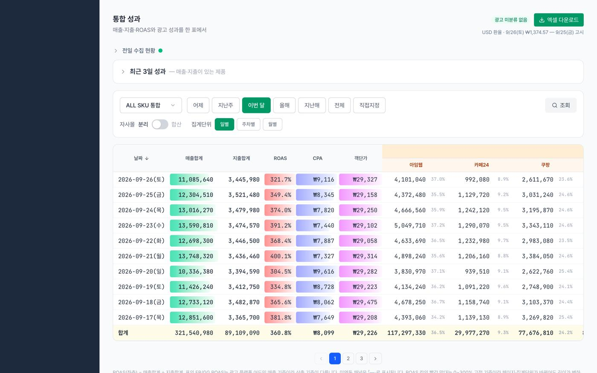
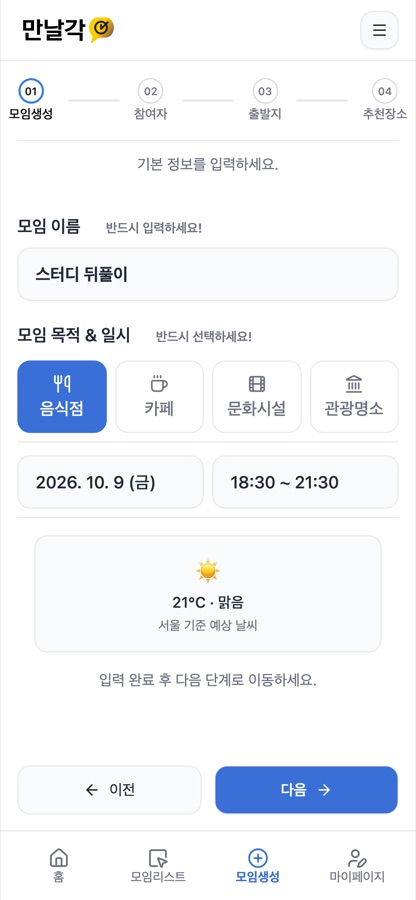
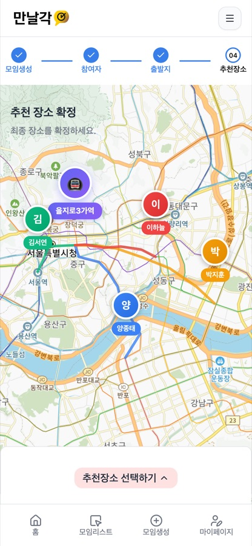
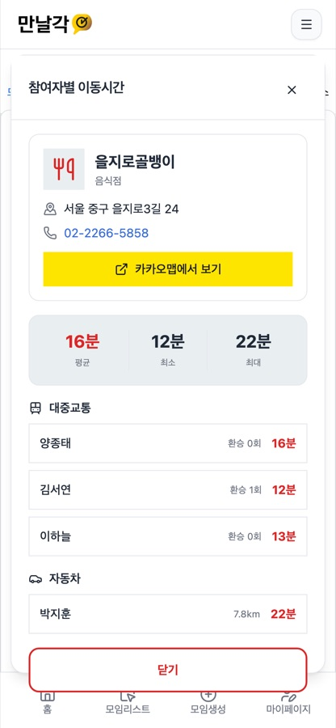
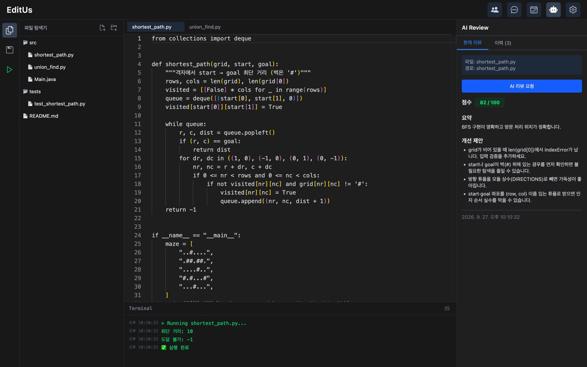
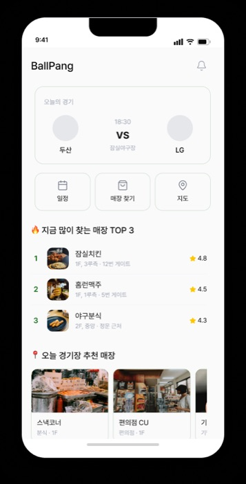
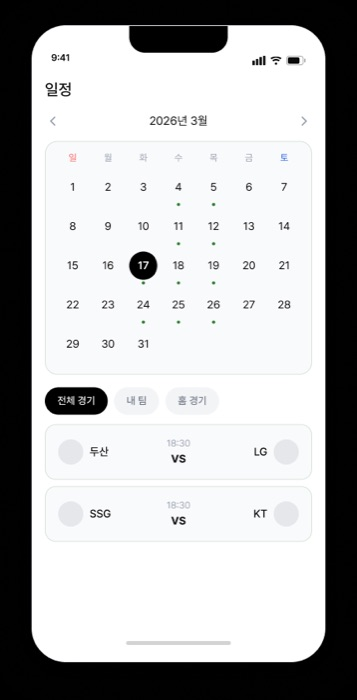
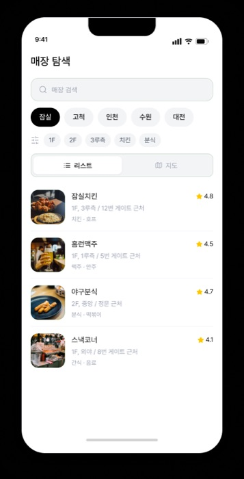

# 양종태 (YANG JONGTAE)

**AI로 빠르게 만들고, 직접 검증하는 개발자**

회사의 유일한 개발자로 사내 운영 플랫폼을 혼자 만들고 운영하고 있습니다. 
팀 프로젝트에서는 백엔드와 실시간 기능을 맡았습니다.

---

##  소개

문제를 먼저 정의하고, **AI에게 맡길 일과 제가 판단할 일을 나눠서** 일합니다.
AI는 빠르지만 틀리기 때문에, 범위와 승인과 검증은 제가 쥡니다.

| 기간 | 내용 |
| --- | --- |
| 2026.02 — 현재 | **사내 개발팀**, 회사의 유일한 개발자로 매출, 광고비, 리셀러 관리 플랫폼을 기획, 개발, 운영 |
| 2026.02 | **구름톤 딥다이브 풀스택 16회차** 수료, 우수수료생 선발 |

**숫자로 보면**

| 1인 | 2~4시간 → 5분 | 0원 | 약 1,470개 |
| :---: | :---: | :---: | :---: |
| 사내 플랫폼 기획, 개발, 운영 | 하루 수작업 시간 | 매출 집계 오차 (원본 대조) | 작성한 테스트 |

---

##  AI와 일하는 방식

| 단계 | 제가 하는 일과 AI에게 맡기는 일 | 남는 결과물 |
| --- | --- | --- |
| **01 정의** | 요청을 요구사항으로 정리하고, "문서만"인지 "구현까지"인지 먼저 정합니다. AI는 코드와 데이터를 읽고 진단 문서를 씁니다. | 요구사항 정의서, 진단 문서 |
| **02 설계** | AI가 후보 비교표와 설계 초안을 만들면, 비용과 운영 조건을 따져 제가 고릅니다. | 설계 문서, 뒤집힌 판단 기록 84건 |
| **03 구현** | 제가 승인한 범위만 구현합니다. 테스트를 먼저 쓰고, 범위가 분명한 기능은 Codex에 맡깁니다. | 커밋 2,059, PR 321 |
| **04 검증** | AI가 테스트와 실측을 돌리고, 저는 결과를 운영 DB, 관리자 화면, 장부와 원 단위로 대조합니다. | 테스트 약 1,470개, 대조검증 문서 |
| **05 기록** | 배포는 제가 직접 합니다. AI의 실수는 다음 작업에서도 읽히는 규칙으로 남깁니다. | CLAUDE.md, 규칙 23개 |

---

##  주요 프로젝트

| # | 프로젝트 | 한 줄 소개 | 역할 | 코드 |
| :---: | --- | --- | --- | :---: |
| 01 | SCR 플랫폼 | 매출, 광고비, 리셀러 관리 사내 플랫폼 | 1인 개발, 운영 | 비공개 (화면, 설명으로 대신) |
| 02 | [ManalGak](https://github.com/CHOSSEANG/ManalGak-magicDev) | 모임 중간 지점 + 맛집 추천 | 팀장, 백엔드 | [공개](https://github.com/CHOSSEANG/ManalGak-magicDev) |
| 03 | [EditUs](https://github.com/whdxo/web_ide_project) | 브라우저 Web IDE + AI 코드 리뷰 | 통합 담당, 풀스택 | [공개](https://github.com/whdxo/web_ide_project) |
| 04 | [BallPang](https://github.com/whdxo/ballpang_app) | 야구장 매장, 경기 일정 통합 앱 | 팀장, 풀스택 | [공개](https://github.com/whdxo/ballpang_app) |

> SCR 플랫폼을 뺀 3개는 **공개 저장소**입니다. 각 프로젝트의 **저장소 바로가기**로 코드를, **케이스 스터디 읽기**로 만든 과정을 볼 수 있습니다.

### 01. SCR 플랫폼 — 매출, 광고비, 리셀러 관리 `실무, 1인 개발`

> 엑셀 매크로로 하던 리셀러 탐지를, 매출, 광고비, 리셀러를 한 화면에서 보는 사내 운영 플랫폼으로 키웠습니다.

> [!NOTE]
> **비공개 프로젝트입니다.** 사내 서비스라 저장소는 공개할 수 없어, 쉬운 설명과 목업 화면, 만든 과정을 케이스 스터디에 정리했습니다.

| 기간 | 역할 | 사용자 | AI |
| --- | --- | --- | --- |
| 2026.02 — 현재 (운영하며 계속 개발) | 사내 유일한 개발자, 기획부터 운영까지 1인 | 대표 포함 사실상 전 직원, 매일 사용 | Claude Code, Codex |

**한눈에 보기**

- 하루 **2~4시간** 걸리던 엑셀 다운로드, 붙여넣기, 수동 검색 → **5분**
- 쇼핑몰 스토어 11곳, 광고 채널 6곳 데이터를 **매일 새벽 사람 없이** 자동 수집
- 에러 없이 틀리던 매출 집계를 원 단위 대조로 잡아 **원본과 0원 차이**
- 아침마다 멈추던 서비스: 로그인 **45초 → 0.5초**, 503 오류 **34건 → 0건**
- 월 운영 비용 **0~7,000원**, 장애도 플랜 상향 없이 해결

 ※ 목업 화면입니다. 매출, 광고비, ROAS 등 모든 숫자는 실제 회사 데이터가 아닌 가상 데이터입니다.

#### 쉽게 말하면

회사는 여러 쇼핑몰에서 물건을 팔고, 여러 곳에 광고를 합니다.
예전에는 직원이 매일 쇼핑몰마다 들어가 주문 엑셀을 내려받고, 광고비를 하나씩 옮겨 적고,
**리셀러**(싸게 대량으로 사서 되파는 사람)를 찾으려고 전화번호, 주소를 한 명씩 검색했습니다.

SCR은 이 일을 대신 해 주는 사내 웹 서비스입니다. 하는 일은 네 가지입니다.

| 단계 | SCR이 하는 일 | 사람이 하던 일 |
| :---: | --- | --- |
| **1. 모으기** | 매일 새벽, 쇼핑몰과 광고 플랫폼에서 주문과 광고비를 자동으로 가져옴 | 사이트마다 들어가 엑셀 내려받기 |
| **2. 보여주기** | 날짜별 매출, 광고비, **ROAS**(광고비 1원당 매출)를 한 화면에 | 엑셀에 손으로 합산 |
| **3. 찾아내기** | 같은 전화번호, 주소로 여러 번 산 주문을 자동으로 의심 목록에 | 한 명씩 최대 24번 검색 |
| **4. 확인하기** | 자동 작업이 잘 돌았는지, 실패한 곳은 없는지 날짜별로 기록 | 없음 (빠져도 몰랐음) |

### 02. [ManalGak](https://github.com/CHOSSEANG/ManalGak-magicDev) — 모임 중간 지점 + 맛집 추천 `팀장, 백엔드`

> 모두의 이동 시간이 비슷한 중간 지점과 장소를 추천하는 모바일 웹

> [!TIP]
> **공개 저장소입니다.** 전체 코드는 저장소에서, 만든 과정과 문제 해결은 케이스 스터디에서 볼 수 있습니다.

| 기간 | 역할 | 맡은 일 | AI |
| --- | --- | --- | --- |
| 2026.01 — 2026.02 (4주, 구름톤 딥다이브 팀 프로젝트) | 팀장, 백엔드 (5명 중 BE 3, FE 2) | 외부 API 연동, Redis 캐시, 지도, 이동시간 화면 | Claude Code (설계, 구현 보고서를 남기며 개발) |

**한눈에 보기**

- 경로 조회 **약 400ms → 약 50ms** (캐시 히트)
- 참여자 4명 경로 **1.2초 → 0.4초** (병렬 조회)
- 데이터마다 다른 캐시 수명: 장소 **1시간**, 경로 **30분**, 막차 **10분**
- 출발지가 바뀌면 **그 모임의 캐시만** 골라 지우고 화면에 실시간 알림

<table align="center">
<tr>
<td align="center" width="50%">
   
  <b>① 모임 만들기</b> 
  모임 이름, 목적(음식점, 카페 등), 날짜와 시간을 고르면 그날 날씨도 함께 보여 줍니다
</td>
<td align="center" width="50%">
   
  <b>② 중간 지점, 추천 장소</b> 
  참여자별 출발지와 경로를 지도에 그리고, 모두에게 공평한 추천 장소를 표시합니다
</td>
</tr>
<tr>
<td align="center" colspan="2">
   
  <b>③ 참여자별 이동시간</b> 
  고른 장소까지 각자 몇 분 걸리는지 대중교통, 자동차로 나눠 비교합니다
</td>
</tr>
</table>

 

### 03. [EditUs](https://github.com/whdxo/web_ide_project) — 브라우저 Web IDE `통합 담당, 풀스택`

> 설치 없이 브라우저에서 함께 코딩하고, 실행하고, AI 리뷰까지 받는 Web IDE

> [!TIP]
> **공개 저장소입니다.** 전체 코드는 저장소에서, 만든 과정과 문제 해결은 케이스 스터디에서 볼 수 있습니다.

-010101?style=flat-square&logo=socketdotio&logoColor=white)

| 기간 | 역할 | 맡은 일 | AI |
| --- | --- | --- | --- |
| 2025.12 (4주, 구름톤 딥다이브 팀 프로젝트) | 통합 담당, 풀스택 (6명 중 커밋 최다) | AI 코드 리뷰, 코드 실행, 채팅 배포 안정화 | 서비스: GPT-4o-mini 개발: Claude Code |

**한눈에 보기**

- 코드 작성 → 실행 → **AI 리뷰(점수, 요약, 개선 제안)** 가 한 화면에서
- Judge0 API로 **10개 언어** 실행 (Python, Java, JavaScript, TypeScript, C, C++, Go, Rust, Ruby, PHP)
- 배포 직후 **채팅 접속자 0명** 장애를 연결 경로 점검으로 찾아 해결
- 팀 채팅은 WebSocket(STOMP) + Redis Pub/Sub, 파일은 AWS S3에 저장

  
   
  코드 작성 → 실행 → AI 리뷰(점수, 요약, 개선 제안)가 한 화면에서

 

### 04. [BallPang](https://github.com/whdxo/ballpang_app) — 야구장 매장, 경기 일정 통합 앱 `팀장, 풀스택`

> 야구장 관람객이 경기 일정, 구장 안 매장, 매장 위치를 한곳에서 확인하는 모바일 앱

> [!TIP]
> **공개 저장소입니다.** 전체 코드는 저장소에서, 만든 과정과 문제 해결은 케이스 스터디에서 볼 수 있습니다.

| 기간 | 역할 | 맡은 일 |
| --- | --- | --- |
| 2025.03 — 2025.11 (핵심 개발 3~6월) | 팀장, 풀스택 (4명 중 커밋 최다) | Firebase 구조 설계, 지도와 매장 마커, 경기 일정, 앱 구조 리팩토링 |

**한눈에 보기**

- 전국 **9개 KBO 구장**의 식음료 매장 정보를 구장별 JSON 스키마로 정리
- Kakao Map 위에 매장 위치를 핀으로 표시하고, **층, 방향, 구역, 음식 종류**로 바로 필터
- 좌표를 **비율 값**으로 저장해 화면 크기가 달라도 마커 위치가 어긋나지 않게
- 시즌 경기 일정을 크롤링해 Firestore에 저장하고, 구장별 날씨(OpenWeather)와 함께 표시

<table align="center">
<tr>
<td align="center" width="50%">
   
  <b>① 홈</b> 
  오늘의 경기, 지금 많이 찾는 매장 TOP 3, 오늘 경기장 추천 매장을 한눈에 봅니다
</td>
<td align="center" width="50%">
   
  <b>② 경기 일정</b> 
  달력에서 날짜를 누르면 그날 경기가 나오고, 전체, 내 팀, 홈 경기로 거를 수 있습니다
</td>
</tr>
<tr>
<td align="center" colspan="2">
   
  <b>③ 매장 탐색</b> 
  구장, 층, 구역, 음식 종류로 매장을 거르고 리스트나 지도로 볼 수 있습니다
</td>
</tr>
</table>

 

#### 그 밖의 프로젝트

| 프로젝트 | 설명 | 역할 | 스택 |
| --- | --- | --- | --- |
| [TripStore](https://github.com/whdxo/travel_project) | 카카오 로그인, 예약 기능을 갖춘 여행 예약 서비스 (클론 코딩 학습) | 팀장, 백엔드 중심 | React, Express, MongoDB, AWS EB |
| [DeliveryCut](https://github.com/whdxo/DeliveryCut) | 냉장고 재료로 10분 한 끼를 추천하는 AI 식단 플래너 | 팀 프로젝트 | TypeScript |
| [locally-app](https://github.com/whdxo/locally-app) | 현지인만 아는 한국을 AI가 번역하는 4개국어 문화 꿀팁 플랫폼 | 개인 | Next.js, TypeScript |
| [BE-HUMAN](https://github.com/whdxo/be_human) | AI 휴머노이드 콘셉트의 인터랙티브 체험 게임 | 팀 프로젝트 | React, Firebase |
| [Term-Health](https://github.com/whdxo/Term-Health) | 개인 건강 관리 모바일 앱 | 팀 프로젝트 | Flutter |

---

##  기술

> 실제로 코드를 작성한 곳만 적었습니다. 팀 프로젝트는 git 작성자 기준입니다.

| 분야 | 기술 | 쓴 곳 |
| --- | --- | --- |
| AI | Claude Code, Codex | 설계, 문서, 디버깅, 리뷰 / 범위가 분명한 백엔드 구현 (SCR) |
| 백엔드 |   | SCR 플랫폼 |
| |   | ManalGak, EditUs |
| |   | TripStore |
| 프론트엔드 |    | SCR, ManalGak, EditUs, TripStore |
| 데이터 |    | 집계 / 서비스 DB / 캐시, 채팅 |
| |   | TripStore / BallPang |
| 실시간 | -010101?style=flat-square&logo=socketdotio&logoColor=white) | ManalGak 추천 동기화, EditUs 채팅 |
| 배포, 운영 |      | SCR 플랫폼, EditUs |
| 모바일 |  | BallPang |

---

##  Contribution

<picture>
  <source media="(prefers-color-scheme: dark)" srcset="https://raw.githubusercontent.com/whdxo/whdxo/output/github-contribution-grid-snake-dark.svg">
  
</picture>

---

**AI가 틀릴 수 있다는 걸 전제로, 끝까지 확인합니다.**

추정하지 않고 실측합니다. 
결과는 바깥 기준과 맞춰 봅니다. 
실수는 규칙으로 남깁니다.

